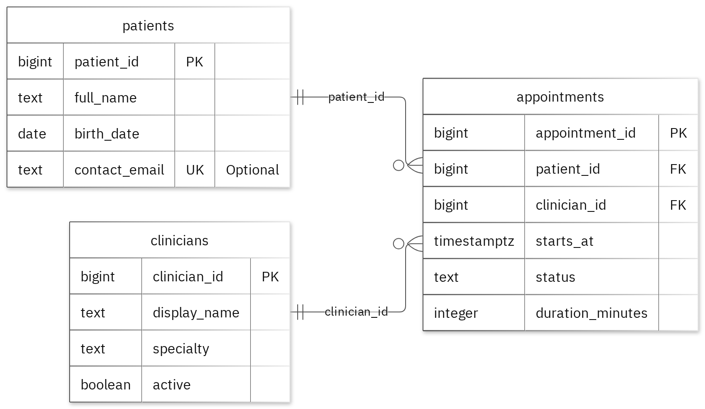

# MIT 8103 Advanced Database Systems

**Smart Clinic Management App** · Adaora Osonwa · Student ID 301928267

## Case study

The case study I chose is on a Smart Clinic Management App. I designed the database for clinic reception staff, doctors, nurses and the clinic administrators, using 3 separate tables named patients, clinicians and appointments. It handles the booking and managing of appointments; reviewing of patient appointment history; and summarizing the clinics appointment activity.

## Portfolio 1: Database Design and Modelling

I setup the relational design into 3 tables. The primary keys identify records, foreign keys preserve the links, and the checks make sure the business rules are met. I added a partial unique index on clinician_id and starts_at specifically for appointments that are booked or checked in, which stops a doctor from having two active appointments at the same time. The normalisation breakdown shows the sample data stepping from 1NF to 2NF and 3NF. All 21 test inserts with bad data were rejected without messing up the correct records.

Figure 1. Tables, keys and relationships. PK: primary key; FK: foreign key; UK: unique value.

<!-- PAGE BREAK -->

## Portfolio 2: Query Processing and Optimisation

I ran three SQL queries against the sample records. The join returned 2 rows and did include Sample Patient One. For the index comparison I loaded in an additional 25,000 performance rows to see how it holds up. The median lookup time went from 1.256ms down to 0.216ms and both phases returned exactly the same records. The query plan confirms that PostgreSQL has indeed picked up the new index. Obviously these timing figures are for that one lookup and my particular machine.

## Portfolio 3: Transactions and Concurrency

I've added a temporary counter column to the appointments table in order to test out COMMIT, ROLLBACK and READ COMMITTED isolation. When Session A made an uncommitted change, Session B completely failed to see it at all and a ROLLBACK would simply wipe the change and restore the original values. Running two simultaneous updates without locking resulted in a classic race condition (we ended up with the counter at 2 rather than the correct value of 3). SELECT FOR UPDATE on Session B forced it to pause until Session A had finished and we then got the correct final count of 3. The column was purely for testing purposes so the actual business logic remains unaltered.

## Portfolio 4: NoSQL and Advanced Data Models

On the NoSQL side I've got a clinic_visit_events collection in Mongodb. It took in 4 sample event documents and returned the correct answers for all 4 test queries. Schema validation picked up on an invalid date format and stopped a duplicate event ID from making it through. The snapshots are embedded so that the relevant visit data is right in the event record where it's needed. Remember these are just mock events, PostgreSQL is still the database of record for enforcing relational integrity.

## Repository and evidence

https://github.com/aosonwa8267/Osonwa_Adaora_301928267

The portfolio folders contain all the SQL and JavaScript, the explanations, the query plans, the result tables and the screenshots.

<!-- PAGE BREAK -->

## Portfolio 5: Distributed and Cloud Database Exercise

I've got a 3 member MongoDB replica set spread across various availability zones. The write-up covers primary elections, majority write acks, secondary replication lag and the trade-offs of sharding the event logs. Having replica nodes ensures the system is available and scheduled backups take care of recovery (PostgreSQL would require its own dedicated failover plan). This was all purely an architectural exercise so no live cluster or failover was actually attempted.

## Individual reflection

I kept patients, clinicians and appointments in separate tables which made it a lot easier to update records (no need to duplicate data across the database). A partial unique index on clinician_id and starts_at proved to be a good solution for preventing double booking on active slots. The concurrency test really drove home the importance of proper locking as otherwise two users will just end up reading the same stale data before they go to save their changes. The query execution plans also taught me that getting the right answer is only half the battle, you also have to ensure that the engine isn't just grinding through a massive amount of extra work in the background.

## AI-use declaration

I used GitHub Copilot and the portfolio generator to produce the database model, the scripts and some of the associated explanations. The tool ran the PostgreSQL and MongoDB exercises, checked the outputs and took the resulting images. I've checked everything and I remain fully responsible for the work that's been submitted.

## References

- [PostgreSQL: constraints](https://www.postgresql.org/docs/17/ddl-constraints.html)
- [PostgreSQL: EXPLAIN](https://www.postgresql.org/docs/17/using-explain.html)
- [PostgreSQL: isolation](https://www.postgresql.org/docs/17/transaction-iso.html)
- [PostgreSQL: row locks](https://www.postgresql.org/docs/17/explicit-locking.html)
- [MongoDB: data modelling](https://www.mongodb.com/docs/manual/data-modeling/)
- [MongoDB: replication](https://www.mongodb.com/docs/manual/replication/)
- [MongoDB: sharding](https://www.mongodb.com/docs/manual/sharding/)
- [Mermaid: ER diagrams](https://mermaid.js.org/syntax/entityRelationshipDiagram.html)

